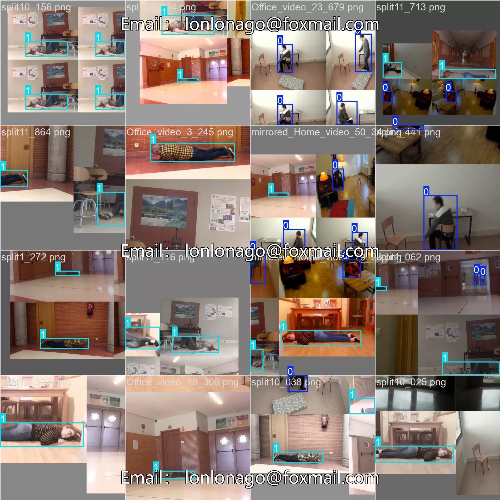
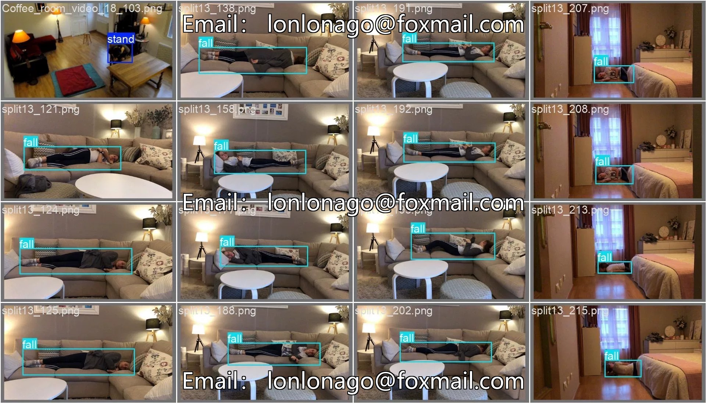
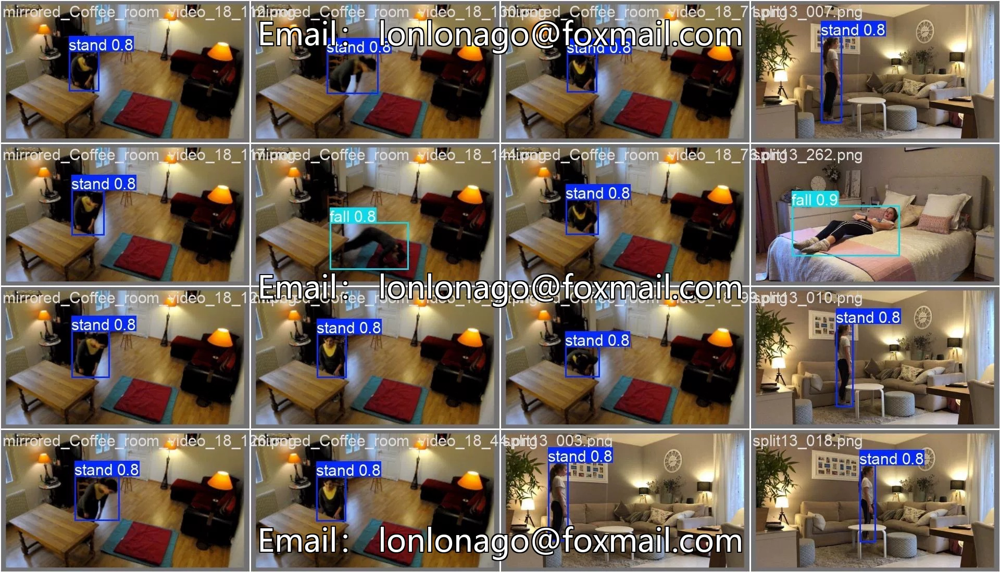
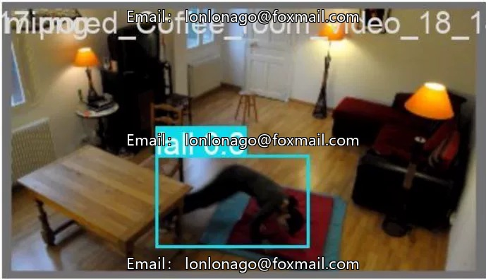

# Smart Home and Security System, based on the deep learning target detection algorithm YOLOv8, room

## Body

Smart Home and Security System, based on the deep learning object detection algorithm YOLOv8, indoor pedestrian fall detection dataset suitable for elderly falls safety detection and smart elderly care scenarios. The dataset includes a training set of 7148 images and a validation set of 2114 images, labeled as "stand" (standing) and "fall" (falling), in YOLOV8 format, directly usable for model training.

Dataset Statistics Table
- Training set: approximately 2500 images, approximately 4600 images in fall
- Validation set: approximately 1673 images, approximately 692 images in fall
- The labeled files and images are named the same, located in the labels folder, with the format class_id center_x center_y width height (normalized coordinates)

Overall Dataset Size
- Training set (train): 7148 images, 7148 annotated files
- Validation set (val): 2114 images, 2114 annotated files

Data Format Explanation
All annotation files are in .txt format, named the same as the images, located in the labels folder. Each line has the following format: class_id center_x center_y width height (normalized coordinates).

Data distribution
- Total number of labeled bounding boxes in training set approximately 7100 (stand about 2500, fall about 4600)
- Total number of labeled bounding boxes in validation set approximately 2365 (stand about 1673, fall about 692)
- Fall class accounts for about 64.3% of the total, Stand class accounts for about 35.7%, indicating a significant imbalance in the classes, possibly highlighting abnormal events.

The product is a virtual material, and once sold, it will not be returned.
Interested friends, click "I want" to proceed.

## Images

## Payment

Here is a pay link on Stripe ( https://buy.stripe.com/3cs8yP7sY87d0vu9AB ). Please contact me lonlonago@foxmail.com after funding $89, and I will send you a complete data files , thank you!

